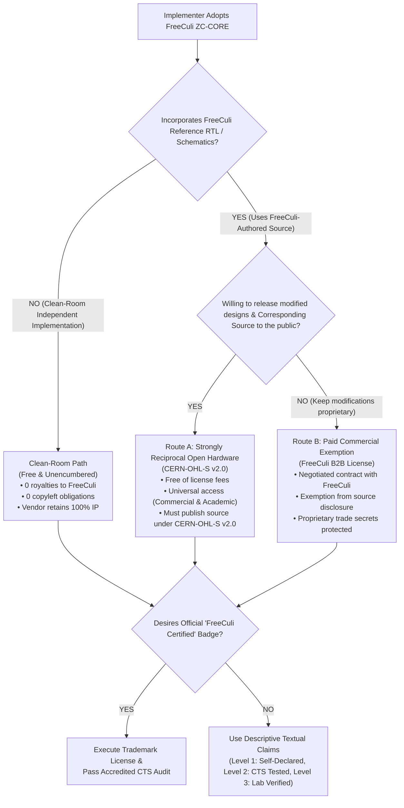

# RFC: FreeCuli ZC-CORE v4.0.0 Dual-Licensing Policy & Commercial Governance

**RFC Identifier:** RFC-ZC-CORE-0002  
**Title:** ZC-CORE v4.0.0 Dual-Licensing Framework, Commercial Exemption Boundaries, and Clean-Room Freedom  
**Author(s):** Google Antigravity (Lead Architecture & Systems Agent) on behalf of FreeCuli Standards Organization  
**Status:** `DRAFT / PROPOSED RFC / NOT RATIFIED / NOT RELEASED`  
**Target Release:** FreeCuli ZC-CORE v4.0.0  
**Baseline Tracking:** `evidence/legal/V4_LEGACY_LICENSING_BASELINE_AUDIT.md`  
**Related Documents:**
- `docs/rfc/ZC-CORE-V4-ARCHITECTURE-RFC.md`
- `docs/rfc/ZC-CORE-V4-TRADEMARK-AND-CONFORMANCE-RFC.md`
- `evidence/legal/V4_LICENSE_SCOPE_AND_RIGHTS_MATRIX.md`
- `evidence/architecture/V4_DEFENSIVE_PUBLICATION_DISCLOSURE_PLAN.md`
- `evidence/architecture/V4_NORMATIVE_MIGRATION_MANIFEST.md`

**Governance Notice:** This document is an architectural Request for Comments (RFC). It does NOT alter the frozen v3.3.0-rc2 historical root documents (`LICENSE`, `zero-cloud-dual-licensing.md`). If ratified following qualified IP counsel review, this RFC will provide the normative basis for the canonical v4.0.0 licensing policy.

---

## 1. Executive Summary & Purpose

The FreeCuli ZC-CORE methodology standardizes hardware-enforced local privacy for server-independent AIoT and Edge AI systems. To maximize universal adoption while sustaining a viable commercial business model, FreeCuli operates under an open and balanced dual-path framework:

> **The Fundamental Dual-Licensing Principle:**  
> *"Use FreeCuli's covered hardware designs under the applicable open-license reciprocal obligations, or obtain a commercial alternative from FreeCuli where FreeCuli has the legal authority to grant it."*

This RFC addresses and remediates the legal ambiguities identified in the legacy v3.x baseline audit (Findings L-01 through L-05):
1. **Eliminates Scope Overreach:** Explicitly affirms that the abstract methodology, causal sequence, and RFC standards (M1–M10) are open for unencumbered implementation. Independent clean-room designs do not require a commercial license.
2. **Restores Open Source Definition (OSD) Compliance:** Removes all restrictions and discrimination against commercial enterprises in the open-hardware path. Any commercial entity may use FreeCuli's reference hardware under `CERN-OHL-S v2.0` without payment, provided they honor source-reciprocity obligations.
3. **Harmonizes SPDX Identifiers:** Distinguishes the pure `CERN-OHL-S-2.0` hardware repository from hypothetical companion software packages, eliminating phantom AGPL claims.
4. **Decouples Trademark from Copyright:** Distinguishes the right to use FreeCuli-copyrighted RTL from the right to display official "FreeCuli Certified™" marks.
5. **Scopes Commercial Licensing to Proven Ownership:** Strictly limits Route B commercial exemptions to assets 100% owned by FreeCuli.

---

## 2. The Two Primary Licensing Pathways



---

## 3. Detailed Specification of Licensing Pathways

### 3.1. Route A: Strongly Reciprocal Open Hardware (CERN-OHL-S v2.0)

#### Scope of Coverage
Route A applies to all reference hardware source files, SystemVerilog modules (`rtl/*.sv`), formal harness source files (`fv/*.sv`), testbenches (`tb/*.sv`), and hardware schematics authored and published by FreeCuli.

#### Governing License Instrument
The open-hardware release is governed by the **CERN Open Hardware Licence Version 2 — Strongly Reciprocal (`CERN-OHL-S-2.0`)**.

#### Universal Rights & Non-Discrimination
In strict adherence to OSD #5 and #6 and CERN-OHL-S v2.0 §3.1:
1. **Any entity**—including multinational commercial corporations, startups, academic institutions, and hobbyists—has the absolute legal right to study, manufacture, modify, and distribute FreeCuli reference hardware free of charge.
2. FreeCuli SHALL NOT require any organization to enter into a paid commercial agreement merely because the organization is commercial, for-profit, or operates in a commercial field of endeavor.

#### Reciprocal Copyleft Obligations
Under CERN-OHL-S v2.0 (§3.2, §3.3, §3.4):
1. **Distribution Trigger:** If a licensee distributes physical hardware products, ASIC chips, FPGA bitstreams, or modified schematics that incorporate or derive from FreeCuli's covered source, the licensee MUST make available the complete **Corresponding Source** (including modified RTL, netlists, schematics, and manufacturing files) under `CERN-OHL-S v2.0`.
2. **Notice Retention:** Licensees must retain all copyright notices, license texts, and attribution notices.
3. **Patent Retaliation:** Bound by the standard patent retaliation terms of CERN-OHL-S v2.0 §4.4.

---

### 3.2. Route B: Commercial B2B Exemption (Proprietary Path)

#### Purpose & Legal Basis
Route B is an optional, contractual commercial agreement between FreeCuli and an organization seeking to build products based on FreeCuli's reference hardware designs without disclosing their proprietary modifications or surrounding ASIC/SoC designs to the public.

#### Eligibility & Scope Boundaries
1. **Applicability:** Route B is available strictly for materials where FreeCuli holds unencumbered copyright ownership (e.g., FreeCuli-authored RTL modules `zc_aon_post_auth_ctrl`, `zc_obi_subordinate_bridge`, `zc_otp_pkg`, `zc_spi_flash_firewall`, and official reference schematics).
2. **Voluntary Selection:** Route B is entirely elective. FreeCuli cannot compel an implementer to purchase Route B unless that implementer distributes hardware derived from FreeCuli's covered source without satisfying CERN-OHL-S v2.0 reciprocal source-sharing obligations.
3. **Third-Party Exclusions:** FreeCuli cannot grant exemptions for upstream open-source IP (e.g., third-party RISC-V cores or OpenTitan components licensed under Apache 2.0).

#### Commercial Exemption Grant
Under a negotiated Route B agreement:
1. FreeCuli grants the commercial licensee a proprietary, non-exclusive license to modify, integrate, and commercially distribute FreeCuli's covered RTL modules and schematics in binary, bitstream, or ASIC form.
2. The licensee is granted an express contractual exemption from the reciprocal source-code release obligations of `CERN-OHL-S v2.0`.
3. The licensee's proprietary trade secrets, custom processor modifications, internal bus architectures, and confidential hardware logic remain completely private.

---

### 3.3. The Clean-Room Freedom Guarantee

To eliminate any chilling effect on industry adoption and uphold intellectual property law (17 U.S.C. § 102(b), TRIPS Art. 9.2):

```
+-------------------------------------------------------------------------------+
|                      CLEAN-ROOM FREEDOM GUARANTEE                             |
|                                                                               |
|  1. The ZC-CORE Methodology, M1-M10 Invariants, Composition Rule, and RFC     |
|     Specifications constitute an OPEN TECHNICAL STANDARD and PUBLIC PRIOR ART.|
|                                                                               |
|  2. Any organization is completely free to independently design, code, and   |
|     manufacture its own RTL, silicon, and hardware products conforming to     |
|     the ZC-CORE methodology from first principles (clean-room engineering).   |
|                                                                               |
|  3. Independent clean-room implementations:                                    |
|     a) Owe NO royalties, licensing fees, or assessments to FreeCuli;          |
|     b) Are NOT subject to CERN-OHL-S v2.0 copyleft obligations;               |
|     c) Do NOT require a Commercial Exemption (Route B) agreement;             |
|     d) Remain 100% the exclusive intellectual property of the implementer.   |
+-------------------------------------------------------------------------------+
```

---

## 4. Software & Firmware Licensing Harmonization

### 4.1. Hardware Repository vs. Software Packages
1. **Current Repository Scope:** The `zero-cloud-hardware-architecture` repository contains hardware specifications, SystemVerilog RTL, formal verification harnesses, testbenches, and verification automation scripts.
2. **Single Canonical License:** All files in this repository are governed by `CERN-OHL-S-2.0`.
3. **De-scoping AGPL-3.0:** The composite SPDX tag `(CERN-OHL-S-2.0 AND AGPL-3.0-or-later)` at repository root is formally declared legacy and deprecated. No AGPL-3.0 code is hosted in this repository.
4. **Future Software Releases:** If FreeCuli releases standalone host software, management daemons, or server-side orchestration platforms in the future:
   - They shall be housed in dedicated software repositories;
   - They shall carry their own independent SPDX identifiers (e.g., `AGPL-3.0-or-later` or `Apache-2.0`);
   - Their software licensing terms shall not infect or alter the hardware licensing of this repository.

---

## 5. Patent Strategy, Retaliation & Defensive Publication

### 5.1. Defensive Prior Art Foundation
FreeCuli does not seek a patent monopoly over the ZC-CORE architecture. Instead, FreeCuli protects the technology against predatory patent trolls and third-party patent assertions through **Defensive Technical Publication**:
1. Every release candidate, architecture RFC, and defensive publication document is timestamped and archived on Zenodo (Concept DOI: `10.5281/zenodo.22838473`) and GitHub.
2. Under 35 U.S.C. § 102(a)(1) and European Patent Convention (EPC) Art. 54(2), these publicly accessible technical disclosures constitute statutory prior art against any subsequent third-party patent application claiming the disclosed combinations.
3. FreeCuli confirms that it has no outstanding patent commitments or grant obligations (e.g., under TÜBİTAK TEYDEB 1501/1507 or ARDEB) mandating patent applications.

### 5.2. Realistic Patent Retaliation Clause
To defend the open ecosystem, FreeCuli incorporates the standard patent retaliation mechanisms of `CERN-OHL-S v2.0 §4.4`:
- If any licensee institutes patent infringement litigation against FreeCuli, its contributors, or other licensees alleging that the covered FreeCuli reference design constitutes direct or contributory patent infringement, that licensee's rights under the CERN-OHL-S v2.0 license shall terminate immediately.
- For Route B commercial licensees, identical defensive termination clauses shall be incorporated into commercial license agreements.

---

## 6. Decoupling from Trademark & Certification

To prevent legal conflation between copyright permissions and brand protection:
1. **Copyright permissions** (Route A, Route B, or Clean-Room) govern the legal right to manufacture and distribute hardware.
2. **Trademark rights** govern the commercial use of the `FreeCuli` name, `ZC-CORE` branding, and official `FreeCuli Certified™` graphical badges.
3. Conformance to the ZC-CORE methodology does NOT require purchasing a commercial license. A clean-room manufacturer who passes accredited third-party testing may obtain an official Trademark License to display the certification badge without needing a Route B copyright exemption.
4. Full rules for brand usage and the 4-level conformance hierarchy are defined in `docs/rfc/ZC-CORE-V4-TRADEMARK-AND-CONFORMANCE-RFC.md`.

---

## 7. Proposed Successor Text for v4.0.0

The following texts are proposed to replace the legacy root `LICENSE` and `zero-cloud-dual-licensing.md` upon formal v4.0.0 ratification:

### 7.1. Proposed v4 `LICENSE` Notice
```markdown
SPDX-License-Identifier: CERN-OHL-S-2.0

======================================================================
FREECULI ZC-CORE ARCHITECTURAL SPECIFICATION & REFERENCE DESIGNS
CANONICAL LICENSE NOTICE (v4.0.0)
======================================================================

Copyright (c) 2026 FreeCuli Standards Organization / Oytun Ciba.
All rights reserved.

1. HARDWARE DESIGNS, RTL & SCHEMATICS (SPDX: CERN-OHL-S-2.0)
   Reference RTL modules, formal harnesses, testbenches, and hardware
   schematics authored by FreeCuli are licensed under the CERN Open
   Hardware Licence Version 2 - Strongly Reciprocal (CERN-OHL-S-2.0).
   Distributing modified covered designs or physical hardware derived
   directly from FreeCuli's covered source requires making Corresponding
   Source available under CERN-OHL-S-2.0.

2. OPEN METHODOLOGY & CLEAN-ROOM FREEDOM
   The ZC-CORE Methodology, M1-M10 Invariants, and RFC specifications
   are open standards and public technical prior art. Any party may
   independently engineer and manufacture clean-room implementations
   without license fees, royalties, or copyleft obligations.

3. COMMERCIAL B2B EXEMPTIONS
   Organizations seeking to incorporate FreeCuli-authored covered RTL
   or schematics into proprietary, closed-source commercial products
   without reciprocal source release may negotiate a commercial license
   with FreeCuli where FreeCuli holds copyright authority.

4. TRADEMARKS & CERTIFICATION
   This license does NOT grant rights to use FreeCuli trademarks or
   certification badges. See docs/rfc/ZC-CORE-V4-TRADEMARK-AND-CONFORMANCE-RFC.md.

Inquiries: info@freeculi.com
```

### 7.2. Proposed v4 `zero-cloud-dual-licensing.md` Summary
```markdown
# ZC-CORE v4.0.0 Dual-Licensing Framework

FreeCuli provides two clear pathways for utilizing FreeCuli-authored hardware:

1. Route A (Open Hardware - CERN-OHL-S v2.0):
   Available to all organizations (commercial and non-commercial).
   Free of charge. Requires reciprocal public disclosure of Corresponding Source.

2. Route B (Commercial B2B Exemption):
   Available for commercial manufacturers seeking to keep FreeCuli-derived
   designs proprietary. Negotiated directly with FreeCuli.

Clean-Room Implementations:
Independent implementations of the ZC-CORE methodology that do not copy
FreeCuli covered source owe no licensing fees and have no copyleft obligations.
```

---

## 8. Governance & Implementation Gates

- **Gate A (Architecture Review):** Complete.
- **Gate B (Remediation Design):** Complete in this RFC.
- **Gate C (Formal Scope & Legal Verification):** In Progress. Requires sign-off by FreeCuli's intellectual property legal counsel before normative ratification.
- **Gate D (v4.0.0 Release Freeze):** Blocked until all RFCs are ratified, CTS is upgraded, and physical tapeout milestones are met.

---
*End of RFC-ZC-CORE-0002 — Proposed Dual-Licensing Policy for ZC-CORE v4.0.0.*
