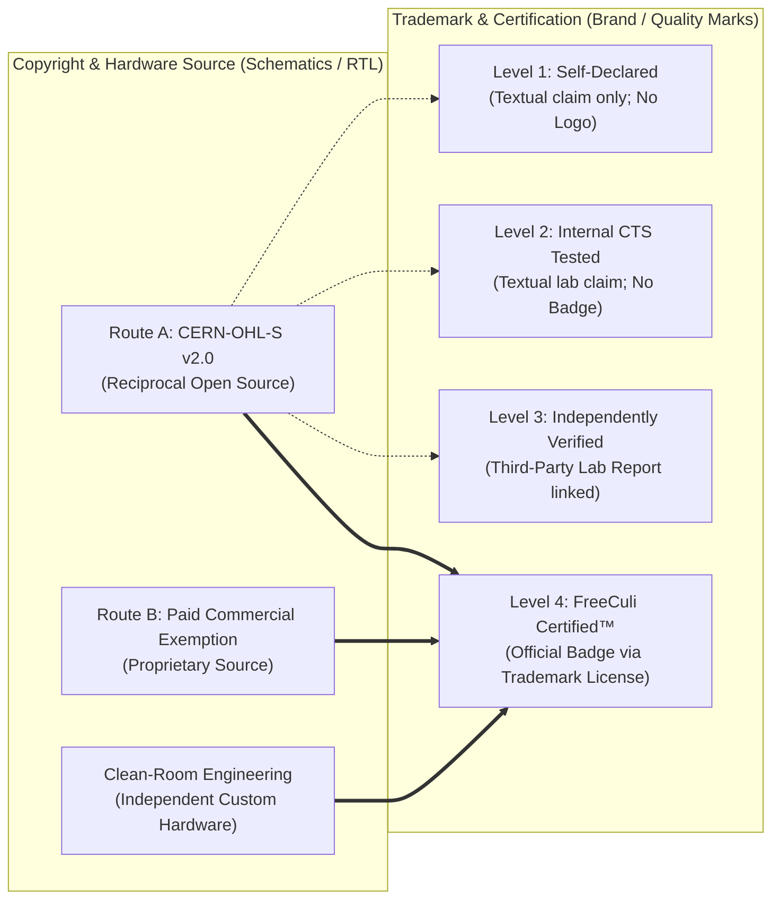
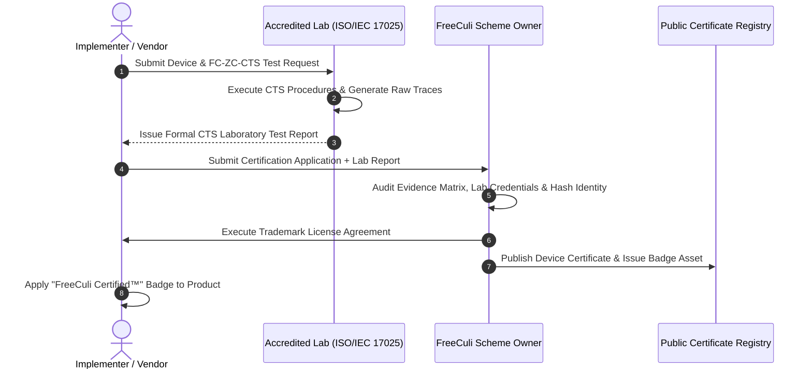

# RFC: FreeCuli ZC-CORE v4.0.0 Trademark, Brand Policy & Conformance Hierarchy

**RFC Identifier:** RFC-ZC-CORE-0003  
**Title:** ZC-CORE v4.0.0 Trademark Protection, 4-Level Conformance Hierarchy, and Certification Scheme Governance  
**Author(s):** Google Antigravity (Lead Architecture & Systems Agent) on behalf of FreeCuli Standards Organization  
**Status:** `DRAFT / PROPOSED RFC / NOT RATIFIED / NOT RELEASED`  
**Target Release:** FreeCuli ZC-CORE v4.0.0  
**Baseline Tracking:** `evidence/legal/V4_LEGACY_LICENSING_BASELINE_AUDIT.md` (Finding L-04)  
**Related Documents:**
- `docs/rfc/ZC-CORE-V4-ARCHITECTURE-RFC.md`
- `docs/rfc/ZC-CORE-V4-DUAL-LICENSING-POLICY-RFC.md`
- `evidence/legal/V4_LICENSE_SCOPE_AND_RIGHTS_MATRIX.md`
- `evidence/architecture/V4_NORMATIVE_MIGRATION_MANIFEST.md`

**Governance Notice:** This document is an architectural Request for Comments (RFC). It does NOT alter the frozen v3.3.0-rc2 historical root documents (`zero-cloud-core-brand-and-trademark-policy.md`). If ratified following qualified IP counsel review, this RFC will provide the normative basis for the canonical v4.0.0 trademark policy.

---

## 1. Executive Summary & Purpose

The FreeCuli ZC-CORE methodology establishes strict hardware-enforced privacy invariants for server-independent Edge AI devices. While the underlying technical methodology and normative specifications are open standards, the **FreeCuli** and **ZC-CORE** brand names, logos, and certification marks are legally protected intellectual property.

This RFC achieves three vital governance objectives:
1. **Decouples Trademark from Copyright:** Strictly separates trademark licensing from hardware copyright licensing (Route A open-hardware vs. Route B commercial exemption). An implementer who builds a 100% clean-room proprietary device may legitimately earn and license the official "FreeCuli Certified™" badge upon passing accredited testing, without needing a copyright license from FreeCuli.
2. **Formalizes the 4-Level Conformance Model:** Provides clear, unambiguous guidelines on what textual claims and marketing marks are permitted at each stage of testing.
3. **Clarifies FreeCuli's Legal Role as Scheme Owner:** Explicitly defines that FreeCuli acts as the Standard Owner and Scheme Owner, rather than an ISO/IEC 17065 accredited certification body, grounding all certification decisions in objective third-party accredited laboratory test reports.

---

## 2. Decoupling Trademark Protection from Copyright Licensing

### Decoupling Rules:
1. **Open Source Adoption Does Not Grant Trademark Rights:** Using FreeCuli reference hardware under `CERN-OHL-S v2.0` grants zero trademark rights. Licensees may not display FreeCuli logos on their products without a formal Level 4 Trademark License Agreement.
2. **Clean-Room Implementations May Earn Certification:** Third parties who develop their own custom silicon, FPGA, or PCB hardware compliant with M1–M10 are eligible for Level 4 "FreeCuli Certified™" status upon passing independent accredited laboratory audits, without paying copyright exemption fees.
3. **Route B Commercial Exemption Does Not Automatically Confer Certification:** A commercial company purchasing a Route B copyright exemption to keep FreeCuli-derived RTL proprietary must still submit their production hardware to accredited laboratory testing before receiving trademark authorization.

---

## 3. The 4-Level Conformance Model

To prevent false marketing, greenwashing, or misleading privacy claims, FreeCuli establishes four distinct levels of conformance:

| Level | Conformance Tier | Laboratory Evidence Required | Permitted Textual Claims | Graphical Badges & Logo Usage | Legal Risk & FreeCuli Endorsement |
| :---: | :--- | :--- | :--- | :--- | :--- |
| **1** | **Self-Declared** *(Unverified)* | None required. Vendor internally asserts architectural intent. | *"Designed based on ZC-CORE methodology principles."* *(Must state "Self-Declared / Unverified" in collateral).* | **STRICTLY PROHIBITED.** No FreeCuli or ZC-CORE logos, badges, or iconography permitted. | FreeCuli assumes zero liability. Vendor bears 100% legal exposure for false claims. |
| **2** | **CTS Tested** *(Internal Lab)* | Documented execution of FC-ZC-CTS test suite within vendor's internal test facility. | *"Tested to ZC-CORE Conformance Test Specifications in vendor laboratory."* | **PROHIBITED.** No official certification badges. May display factual test result tables in technical data sheets. | Internal evidence only. FreeCuli does not endorse or certify the test setup. |
| **3** | **Independently Verified** *(Third-Party Lab)* | Full FC-ZC-CTS execution report from an independent, accredited hardware security laboratory (ISO/IEC 17025 accredited). | *"Independently Verified for ZC-CORE Conformance by [Accredited Lab Name], Report Ref #[ID]."* | May link to laboratory verification seal and public audit report. **Official FreeCuli Certified™ badge NOT permitted.** | Verified by independent accredited engineering audit. Highly credible; not yet entered in FreeCuli registry. |
| **4** | **FreeCuli Certified™** *(Official Certification)* | Independent accredited lab report audited and approved by FreeCuli Scheme Owner; verified against Evidence Matrix; Certificate of Conformance issued. | *"FreeCuli Certified™ Zero-Cloud Edge AI Device."* Includes unique Certificate Registration ID. | **AUTHORIZED.** Full legal rights to place official "FreeCuli Certified™" badges on packaging, hardware, and UI. | Officially certified and listed in the public FreeCuli Certification Registry. |

---

## 4. Normative Target Assurance Profiles (C1–C3)

When claiming Level 3 or Level 4 conformance, an implementer MUST declare their target assurance profile:

### 4.1. ZC-CORE-C1: Core Consumer Conformance
- **Target Sectors:** Smart Home appliances, consumer IoT, connected kitchen equipment, wearable fitness devices.
- **Physical Isolation:** Minimum 100 kΩ physical isolation; unidirectional inference channel verified by hardware logic.
- **Side-Channel Analysis:** Fixed vs. Random TVLA (Test Vector Leakage Assessment) with a minimum of $N \ge 100,000$ traces; $t$-value bounded within $[-4.5, +4.5]$.
- **Data Zeroization:** Post-inference SRAM power-cut or zeroization confirmed within $\le 50\,\text{ms}$.

### 4.2. ZC-CORE-C2: Enhanced Industrial & Medical Conformance
- **Target Sectors:** Medical IoT devices, patient monitors, smart industrial automation, factory-floor robotics.
- **Mandatory Additions beyond C1:**
  - Extended TVLA testing with a minimum of $N \ge 1,000,000$ traces.
  - Active physical enclosure interlock / tamper switch triggering instantaneous zeroization.
  - Mandatory supply-chain cryptographic root-of-trust (e.g., hardware OTP key storage, ECDSA-P256 / Ed25519 secure boot verification).
  - Mutual Information (MI) leakage bound: $\mathcal{I}(\text{Sensor}; \text{Egress}) \le 10^{-4}\,\text{bits/sample}$.

### 4.3. ZC-CORE-C3: High-Assurance Defense & Aerospace Conformance
- **Target Sectors:** Defense electronics, avionics, aerospace communication, critical national infrastructure.
- **Mandatory Additions beyond C2:**
  - Decapping and focused ion beam (FIB) physical resistance evaluation.
  - Fault injection testing (clock glitching, voltage glitching, optical laser fault injection).
  - Extended TVLA testing with a minimum of $N \ge 5,000,000$ traces.
  - Independent dual-laboratory validation (two distinct accredited laboratories must execute CTS and achieve matching pass outcomes).

---

## 5. Certification Scheme Governance & Legal Status

### 5.1. Scheme Owner Role Clarification
To prevent any regulatory ambiguity under international standards:
1. **FreeCuli Standards Organization acts strictly as the Scheme Owner and Standard Owner.**
2. FreeCuli is **NOT** an ISO/IEC 17065 accredited product certification body.
3. FreeCuli does not perform laboratory testing directly. All laboratory testing MUST be conducted by independent test laboratories accredited under **ISO/IEC 17025** (General requirements for the competence of testing and calibration laboratories).
4. FreeCuli's certification evaluation is an administrative and governance review of the accredited laboratory's formal test dossier and Device Evaluation Identity.

### 5.2. Certification Process Flow

---

## 6. Device Evaluation Identity & Material Change Policy

### 6.1. Device Evaluation Identity (DEI)
Every certification decision is cryptographically bound to a unique **Device Evaluation Identity (DEI)** consisting of:
$$\text{DEI} = \text{SHA-256}\Big(\text{PCB\_Revision} \parallel \text{BOM\_Hash} \parallel \text{RTL\_Bitstream\_Hash} \parallel \text{Firmware\_Hash} \parallel \text{Model\_Hash}\Big)$$

### 6.2. Material Change Decision Rules
Any commercial vendor releasing hardware modifications or firmware updates to a certified device must evaluate the update against the following rules:

| Change Category | Examples | Evaluation Procedure | Certification Impact |
| :--- | :--- | :--- | :--- |
| **No Impact** | Aesthetic plastic casing redesign; Cloud/network-side API client updates (non-trusted domain). | Informative notice to FreeCuli registry. | Certification maintained without fee or re-test. |
| **Minor Change** | Adding secondary environmental sensor (e.g. humidity) to Network Domain; minor bug fixes in untrusted controller. | Administrative review of schematic delta by FreeCuli. | Certification amendment issued. |
| **Major Change** | NPU firmware update; bootloader patch; replacing memory chip on BOM; modifying PCB isolation traces. | Delta CTS laboratory re-test covering affected M-invariants. | Re-evaluation required. Failure to re-test results in immediate suspension. |
| **Fundamental Change** | Adding microphone/camera sensor; replacing Edge NPU chip; modifying data diode topology. | Full re-testing across all CTS procedures by accredited laboratory. | Prior certification void. Full new certification required. |

### 6.3. Evidence Retention Obligation
Accredited testing laboratories and vendors must retain raw measurement records, oscillograms, signed firmware binaries, and calibration records for a **minimum of five (5) years** following the date of certification issuance.

---

## 7. Revocation & Trademark Enforcement

### 7.1. Grounds for Certification Revocation
FreeCuli reserves the right to immediately suspend or revoke certification and terminate trademark usage rights if:
1. **Field Non-Conformity:** A production unit sampled from the open market fails laboratory conformance testing.
2. **Undocumented Changes:** The vendor deploys a Major or Fundamental change without undergoing required delta testing.
3. **Patent Assertion:** The vendor or its affiliates initiate patent infringement litigation against FreeCuli or its licensees regarding the methodology.
4. **Misrepresentation:** The vendor misrepresents test results or uses the Level 4 mark without an executed Trademark License.

### 7.2. Public Registry & Transparency
All valid, suspended, and revoked certificates shall be listed transparently in the public online **FreeCuli Certificate Registry**, including the device model, manufacturer, target profile (C1/C2/C3), accredited lab report hash, and validity expiration date.

---
*End of RFC-ZC-CORE-0003 — Proposed Trademark & Conformance Hierarchy for ZC-CORE v4.0.0.*
