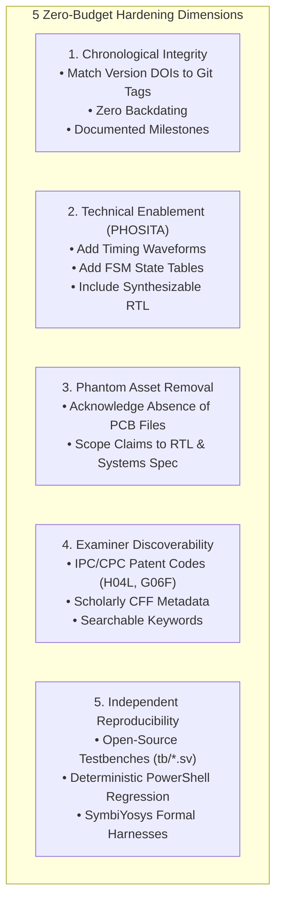

# FREECULI ZC-CORE — v4.0.0 Defensive Publication Hardening Plan

**Document ID:** ZC-CORE-PLAN-PUB-HARDENING-01  
**Project:** FreeCuli ZC-CORE Hardware Architecture & Methodology  
**Target Release:** v4.0.0 Architecture & Defensive Publication Package  
**Document Classification:** Zero-Budget Prior-Art Hardening Plan  
**Location:** `evidence/audit/V4_DEFENSIVE_PUBLICATION_HARDENING_PLAN.md`  
**Governance Status:** `DRAFT WORKING PLAN / NOT RELEASED / NO ZENODO MINTING AUTHORIZED`  
**Related Documents:**
- `evidence/audit/V4_STRATEGIC_IP_INDEPENDENT_AUDIT.md`
- `evidence/architecture/V4_DEFENSIVE_PUBLICATION_DISCLOSURE_PLAN.md`
- `docs/rfc/ZC-CORE-V4-ARCHITECTURE-RFC.md`

---

## 1. Executive Charter: Zero-Budget Prior-Art Defense

FreeCuli's intellectual property defense is built entirely upon **public, timestamped, technically enabling disclosures** that establish prior art under 35 U.S.C. § 102 (United States) and Article 54 of the European Patent Convention (EPC). 

### Fundamental Principle
> *"A defensive publication may provide evidence relevant to assessing the novelty or patentability of later patent claims, subject to applicable law, publication accessibility and timing, and the technical sufficiency of the disclosure."*

This hardening plan establishes a sequence of **zero-budget technical improvements** to maximize the defensive strength and legal discoverability of FreeCuli's disclosures on GitHub and Zenodo.

---

## 2. Hardening Strategy Across 5 Priority Dimensions



---

## 3. Prioritized Action Matrix

| Priority | Action ID | Action Title | Target Files / Venues | Technical Implementation | Zero-Budget Mechanism | Expected Prior-Art Impact |
| :---: | :---: | :--- | :--- | :--- | :--- | :--- |
| **P1** | **ACT-01** | **Eliminate Phantom PCB Claims** | `docs/rfc/ZC-CORE-V4-ARCHITECTURE-RFC.md`<br>`evidence/legal/V4_LEGACY_LICENSING_BASELINE_AUDIT.md` | Explicitly state that v3.x/v4.0.0 releases publish digital RTL and systems specifications, NOT physical PCB CAD/Gerber designs. | Pure documentation edit; prevents false prior-art claims. | Protects credibility; prevents competitors from discrediting the entire disclosure due to missing CAD files. |
| **P1** | **ACT-02** | **Zenodo Version-Mapping Audit** | `evidence/audit/V4_STRATEGIC_IP_INDEPENDENT_AUDIT.md`<br>Zenodo Metadata Record | Map each historical release (`v3.2.0`, `v3.2.1`, `v3.3.0-rc2`) to its exact Version DOI, commit SHA, and exact file manifest. | Archival inspection of existing Zenodo records. | Enables patent litigators/examiners to cite the exact historical Version DOI where each claim first appeared. |
| **P2** | **ACT-03** | **SPI Firewall Timing Waveform Enablement** | `docs/rfc/ZC-CORE-V4-ARCHITECTURE-RFC.md`<br>`docs/architecture/zc-core-hybrid-interconnect.md` | Add ASCII timing diagram illustrating Layer 1 status reconciliation: `sck`, `cs_n`, opcode `05h`, status polling (`SR1[1:0] == 2'b00`), and `bank_b_commit_ready_o` gating. | Markdown ASCII diagram. | Satisfies PHOSITA enablement requirement for circuit timing without needing physical silicon test chips. |
| **P2** | **ACT-04** | **OBI Decoupling Bridge FSM State Table** | `docs/rfc/ZC-CORE-V4-ARCHITECTURE-RFC.md` | Document explicit FSM state transition matrix (`ST_IDLE`, `ST_BUSY`, `ST_TIMEOUT_ERR`, `ST_TRAP`), 10-bit watchdog counter rollover, and synthetic error response cycle. | Markdown state table and mermaid flowchart. | Prevents third parties from patenting bus decoupling error traps by demonstrating complete prior disclosure. |
| **P3** | **ACT-05** | **Hsiao (22,16) Code Weight & Syndrome Table** | `docs/rfc/ZC-CORE-V4-ARCHITECTURE-RFC.md` | Insert complete syndrome decoding table, Hamming weight distribution (range [8..14]), and explicit parity generation equations $p_0..p_5$. | Markdown mathematical table. | Documents technical subject matter potentially relevant as prior art concerning OTP eFuse anti-rollback codewords and collision-free seal masks; its legal effect depends on the applicable law and facts. |
| **P3** | **ACT-06** | **IPC / CPC Examiner Search Optimization** | `CITATION.cff`<br>`evidence/architecture/V4_DEFENSIVE_PUBLICATION_DISCLOSURE_PLAN.md` | Include standard patent classification codes: `H04L 9/00`, `G06F 21/50`, `G06F 21/70`, `G06N 3/04`, `H04W 12/00` in repository root metadata. | Text metadata addition. | Maximizes probability that USPTO and EPO examiners will retrieve FreeCuli disclosures during patent prior-art searches. |
| **P4** | **ACT-07** | **Zero-Dependency Reproducibility Guide** | `README.md` (v4 successor draft)<br>`scripts/verify_gate_b_rev28d.ps1` | Document exact procedure to run the 20 structural regression tests using native PowerShell without requiring proprietary EDA software. | Open script and documentation. | Proves that the disclosed logic is mathematically and structurally verified, not hypothetical speculation. |

---

## 4. Technical Enablement (PHOSITA) Assessment Guidelines

To ensure disclosures are robust against future patent challenges without over-promising, technical details must be calibrated to the specific nature of each claim:

```
+---------------------------------------------------------------------------------------------------+
|                               PHOSITA ENABLEMENT CALIBRATION TABLE                                |
+---------------------------------------------------------------------------------------------------+
|  CLAIM CATEGORY        | REQUIRED DISCLOSURE LEVEL FOR PRIOR ART   | CURRENT STATUS IN FREECULI   |
+------------------------+-------------------------------------------+------------------------------+
|  1. Methodological     | High-level causal sequence, domain        | FULLY SATISFIED              |
|     Architecture       | boundary definitions, data taxonomy.      | (M1-M10, Scope Boundary)     |
+------------------------+-------------------------------------------+------------------------------+
|  2. Bus Interconnect   | Register map, handshake state machine,   | PARTIALLY SATISFIED          |
|     Logic (OBI/SPI)    | bus timing constraints, error response.   | (RTL present; diagrams needed)|
+------------------------+-------------------------------------------+------------------------------+
|  3. Cryptographic/OTP  | Parity matrix, Hamming weight bounds,     | FULLY SATISFIED              |
|     Anti-Rollback      | DAI handshake phases, reset behavior.     | (zc_otp_pkg.sv, SVA proofs)  |
+------------------------+-------------------------------------------+------------------------------+
|  4. PCB / Electrical   | Component schematics, trace routing,     | NOT SATISFIED                |
|     Physical Layout    | ground plane separation, BOM part numbers.| (Ghost Asset - Must de-scope)|
+------------------------+-------------------------------------------+------------------------------+
```

### Action Directive for PCB Materials:
Because no KiCad, Altium, or Gerber files exist in the repository, **FreeCuli must explicitly declare in all v4 documentation that the architecture is technology-neutral and RTL/systems-level, rather than claiming prior art over specific unpublished PCB board artwork**.

---

## 5. Zenodo Archival & Coordination Roadmap (Post-Approval)

When the project owner and auditor formally approve the v4.0.0 package, the Zenodo archival release shall be coordinated under the following strict rules:

1. **Never Backdate:** The publication date on Zenodo must match the exact real-world release date (e.g., November 2026).
2. **Archival Bundle Contents:**
   - All ratified v4.0.0 RFC specifications (`docs/rfc/*.md`).
   - All synthesizable SystemVerilog modules (`rtl/*.sv`).
   - All formal verification assertions and testbenches (`fv/*.sv`, `tb/*.sv`).
   - Deterministic verification scripts (`scripts/verify_gate_b_rev28d.ps1`).
   - Cryptographic release manifest with SHA-256 signatures.
3. **Link to Predecessor:** Link the new release to predecessor Version DOIs under Concept DOI `10.5281/zenodo.22838473`, clearly stating:
   - *v3.3.0-rc2 (Sept 2026):* Prior art for systems methodology and M1–M10 invariants.
   - *v4.0.0 (Current):* Prior art for concrete digital RTL firewalls, OBI bus decoupling, and AON anti-rollback logic.

---
*End of V4_DEFENSIVE_PUBLICATION_HARDENING_PLAN.md — Prepared for FreeCuli Architecture & Governance Review.*
