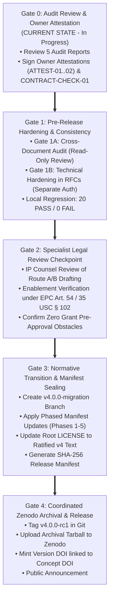

# FREECULI ZC-CORE — v4.0.0 Implementation & Release Gate Plan

**Document ID:** ZC-CORE-PLAN-GATE-01  
**Project:** FreeCuli ZC-CORE Hardware Architecture & Methodology  
**Target Release:** v4.0.0 Architecture & Licensing Transition  
**Document Classification:** Ordered Implementation Plan & Release Gates  
**Location:** `evidence/audit/V4_IMPLEMENTATION_AND_RELEASE_GATE_PLAN.md`  
**Governance Status:** `DRAFT IMPLEMENTATION PLAN / PRE-AUTHORIZATION`  
**Current Gate Status:** `Gate C: PARTIAL / QUALIFIED` | `Gate D: UNVERIFIED`  
**Mandatory Directive:** `STOP AFTER THE AUDIT — WAIT FOR OWNER & AUDITOR APPROVAL PRIOR TO IMPLEMENTATION`  
**Related Documents:**
- `evidence/audit/V4_STRATEGIC_IP_INDEPENDENT_AUDIT.md`
- `evidence/audit/V4_DEFENSIVE_PUBLICATION_HARDENING_PLAN.md`
- `evidence/audit/V4_LICENSE_AND_RIGHTS_RISK_REGISTER.md`
- `evidence/audit/V4_NORMATIVE_CONFLICT_MATRIX.md`
- `evidence/architecture/V4_NORMATIVE_MIGRATION_MANIFEST.md`

---

## 1. Executive Summary & Implementation Sequence

This plan defines a safe, reversible, and phased execution roadmap to transition FreeCuli ZC-CORE from its current draft RFC state to a formally ratified, publicly disclosed v4.0.0 architecture. 

In strict adherence to the Independent Auditor's mandate:
- **No changes are made to production code, root licenses, or frozen normative files at this stage.**
- Every step is governed by a **strict pre-flight gate** requiring documented evidence and explicit approval.
- Every release artifact must be traceable to reproducible testbenches and cryptographic commit hashes.

---

## 2. The 5 Phased Implementation & Release Gates

---

## 3. Detailed Gate Criteria and Required Verification Artifacts

### 3.1. Gate 0: Independent Audit Review & Owner Sign-Off (Current Milestone)
* **Objective:** Review the completed independent audit reports and secure necessary founder factual attestations.
* **Prerequisites:**
  - [x] Complete `V4_STRATEGIC_IP_INDEPENDENT_AUDIT.md`.
  - [x] Complete `V4_DEFENSIVE_PUBLICATION_HARDENING_PLAN.md`.
  - [x] Complete `V4_LICENSE_AND_RIGHTS_RISK_REGISTER.md`.
  - [x] Complete `V4_NORMATIVE_CONFLICT_MATRIX.md`.
  - [x] Complete `V4_IMPLEMENTATION_AND_RELEASE_GATE_PLAN.md`.
* **Required Actions Prior to Advancing to Gate 1:**
  - Founder review and formal written approval of audit findings.
  - Recording of `ATTEST-01` (Ownership and Development History: The founder represents that they are the sole developer and rights holder of ZC-CORE. The reviewed Git history is consistent with the founder's representation of sole development. This record documents the founder's representation and its comparison against the reviewed technical records).
  - Recording of `ATTEST-02` (Brand and Source Identification: Common-law trademark recognition of `FreeCuli` and `ZC-CORE`).

---

### 3.2. Gate 1: Pre-Release Hardening and Consistency Audit

Gate 1 is structured into two distinct, sequentially governed sub-phases:

#### Gate 1A: Cross-Document Evidence & Consistency Audit (Read-Only Review & Evaluation)
* **Objective:** Perform a rigorous, read-only cross-document consistency audit across all audit records and risk registers; reconcile conflicting statements, qualify ownership claims, and ensure cryptographic checksum integrity.
* **Governing Rule:** Gate 1A operates strictly under `READ-ONLY / NO FILE CHANGES / STAND DOWN`. Completing Gate 1A consistency reconciliations closes audit discrepancies but **does NOT close Gate 1 or authorize public release**. Gate 1 remains open until Gate 1B and all exit criteria are satisfied under separate authorization.

#### Gate 1B: Safe Pre-Release Technical Hardening (Drafting Waveforms/Tables in RFCs under Separate Authorization)
* **Objective:** Enhance technical enablement in draft RFC documents without modifying root normative files, under separate explicit founder authorization.
* **Target Actions:**
  1. **ACT-01 (Phantom PCB De-scoping):** Update `docs/rfc/ZC-CORE-V4-ARCHITECTURE-RFC.md` to state explicitly that current published materials comprise digital RTL modules and systems specifications, not physical PCB board artwork.
  2. **ACT-03 (SPI Waveforms):** Insert ASCII/Mermaid timing waveforms into `docs/rfc/ZC-CORE-V4-ARCHITECTURE-RFC.md` illustrating 3-layer SPI status reconciliation.
  3. **ACT-04 (OBI State Table):** Add FSM transition table for OBI subordinate decoupling watchdog and synthetic error trap.
  4. **ACT-06 (IPC/CPC Codes):** Add patent classification metadata (`H04L 9/00`, `G06F 21/50`, `G06F 21/70`, `G06N 3/04`, `H04W 12/00`) into `CITATION.cff`.
* **Verification Gate:** Run `scripts/verify_gate_b_rev28d.ps1` and confirm **PASS=20, FAIL=0**.

---

### 3.3. Gate 2: Specialist Legal Review Checkpoint
* **Objective:** Ensure all contractual, licensing, and prior-art terms withstand scrutiny before public activation.
* **Scope of Review:**
  1. Verify that `ZC-CORE-V4-DUAL-LICENSING-POLICY-RFC.md` strictly adheres to CERN-OHL-S v2.0 reciprocity terms and does not create antitrust or OSD violations.
  2. Confirm that the Clean-Room Freedom Guarantee properly reflects international copyright doctrine (17 U.S.C. § 102(b)).
  3. Verify that defensive disclosure descriptions meet international patent enablement standards (EPC Art. 54; 35 U.S.C. § 102).
* **Exit Criterion:** Written clearance from qualified IP counsel.

---

### 3.4. Gate 3: Normative Transition & Manifest Sealing
* **Objective:** Atomically transition root repository files to the ratified v4.0.0 normative baseline.
* **Branch Strategy:**
  - Work on a dedicated migration branch (`v4.0.0-migration`) branched from `gate-c/formal-scope-audit`.
  - Maintain `main` and `v3.3.0-rc2` historical tags untouched.
* **Execution Sequence (Per `V4_NORMATIVE_MIGRATION_MANIFEST.md`):**
  - **Phase 1:** Update `zero-cloud-core-methodology-invariants.md` (Integrate `M3-RFC-REVISED`) and `zero-cloud-core-scope-boundary.md` (5-class taxonomy).
  - **Phase 2:** Update `zero-cloud-core-attack-taxonomy.md` (AT-011, AT-012) and reference architecture.
  - **Phase 3:** Update `zero-cloud-core-conformance-test-specification.md` (Modular CTS-v4 suites).
  - **Phase 4:** Update `zero-cloud-core-defensive-publication.md` (Claim Family ZC-CORE-008).
  - **Phase 5:** Update root `LICENSE` and `zero-cloud-dual-licensing.md` to ratified v4 text.
  - **Manifest Seal:** Compute SHA-256 hashes for all v4 normative files and record in `ZERO-CLOUD-RELEASE-MANIFEST-V4.md`.
* **Exit Criterion:** All 20 structural regression tests pass; git tree matches manifest hashes.

---

### 3.5. Gate 4: Coordinated Zenodo Archival & Public Release
* **Objective:** Permanently seal the v4.0.0 release as timestamped, immutable prior art.
* **Release Steps:**
  1. Create cryptographically signed Git tag: `v4.0.0-rc1`.
  2. Bundle all repository source files into release tarball (`zero-cloud-hardware-architecture-v4.0.0-rc1.tar.gz`).
  3. Compute SHA-256 hash of distribution archive.
  4. Upload to Zenodo under Concept DOI `10.5281/zenodo.22838473` as a new version.
  5. Zenodo assigns immutable Version DOI and timestamp.
  6. Announce release on public channels.

---

## 4. Answers to the 8 Mandatory Completion Criteria Questions

### 1. What protection does FreeCuli demonstrably possess today?
- **Defensive Prior Art (Systems Spec):** Established under Zenodo Concept DOI `10.5281/zenodo.22838473` (dated 2026-09-25) covering the abstract ZC-CORE methodology, M1–M10 causal sequence, and high-level trust boundary.
- **Defensive Prior Art (Digital RTL Circuits):** Established under GitHub commit history (dated 2026-10-18 through 2026-10-20) covering concrete SystemVerilog implementations of `zc_aon_post_auth_ctrl`, `zc_obi_subordinate_bridge`, `zc_spi_flash_firewall`, and `zc_otp_pkg`.
- **Copyright Protection:** Copyright ownership over the authored RTL modules, formal assertion harnesses, testbenches, and specification texts, as represented by the founder; reviewed Git commit records are consistent with that representation but do not independently establish legal title.
- **Common-Law Trademark:** Prior commercial/public usage rights over the names `FreeCuli` and `ZC-CORE` in the server-independent Edge AI domain.

### 2. What does the current publication strategy not protect?
- **No Patent Monopoly:** FreeCuli cannot stop a third party from practicing the technology, nor sue for patent infringement.
- **No Prior Art over Physical PCB Artwork:** Because zero CAD/Gerber files were committed to the repository, FreeCuli possesses zero published prior art over board-level layouts or trace geometry.
- **No Protection Against Independent Inventions for Unimplemented Concepts:** Multi-master SoC crossbar DMA firewalling and analog side-channel mutual information bounds remain research targets (Gate D) and do not yet constitute enabling prior art.

### 3. What was genuinely completed in commit `7982771`?
- Authored the comprehensive legacy licensing baseline audit (`V4_LEGACY_LICENSING_BASELINE_AUDIT.md`, +216 lines).
- Established the 10-category rights and licensing matrix (`V4_LICENSE_SCOPE_AND_RIGHTS_MATRIX.md`, +92 lines).
- Formulated the draft v4 dual-licensing RFC (`ZC-CORE-V4-DUAL-LICENSING-POLICY-RFC.md`, +236 lines).
- Formulated the draft v4 trademark and conformance RFC (`ZC-CORE-V4-TRADEMARK-AND-CONFORMANCE-RFC.md`, +167 lines).
- Updated the defensive publication plan and normative migration manifest (+46 lines).
- **All authored materials are non-normative DRAFT RFC proposals; zero production RTL or root normative files were modified.**

### 4. Which legal or technical claims are unsupported?
- **Unsupported Claim 1:** Claims in root `LICENSE` and dual-licensing docs that CERN-OHL-S covers reference PCB layouts and Gerber files (these files do not exist in the repo).
- **Unsupported Claim 2:** Claims in legacy `LICENSE` that all implementations of the abstract methodology require a commercial license if proprietary.
- **Unsupported Claim 3:** Claims that root repository software is licensed under AGPL-3.0 (zero AGPL code exists).
- **Unsupported Claim 4:** Any implication that the "™" symbol denotes a registered government trademark certificate.

### 5. What zero-budget improvements offer the highest value?
1. **Adding timing waveforms and FSM state transition tables to RFC drafts** (drastically improves PHOSITA enablement for defensive prior art).
2. **Explicitly eliminating phantom PCB claims** (protects institutional credibility and eliminates false advertising risks).
3. **Adding IPC/CPC classification codes to repository metadata** (ensures USPTO/EPO patent examiners discover FreeCuli disclosures during prior-art novelty searches).
4. **Formally declaring clean-room freedom** (removes legal intimidation, encouraging global commercial adoption).

### 6. Which changes require owner approval or specialist legal review?
- **Owner Approval Required:** Approving the findings of this audit; recording written attestations `ATTEST-01` (RTL authorship) and `ATTEST-02` (brand ownership); and performing `CONTRACT-CHECK-01` (conditional contractual-restriction verification if public grants or institutional sponsorship apply).
- **Specialist Legal Review Required:** Final sign-off by a qualified IP attorney on the contractual terms of `ZC-CORE-V4-DUAL-LICENSING-POLICY-RFC.md` and `ZC-CORE-V4-TRADEMARK-AND-CONFORMANCE-RFC.md` prior to updating root `LICENSE`.

### 7. What exact implementation sequence is recommended?
Execute Gates 0 through 4 sequentially:
`Gate 0 (Audit & Attestation) -> Gate 1A (Read-Only Consistency Audit) -> Gate 1B (RFC Technical Hardening under Separate Auth) -> Gate 2 (Legal Checkpoint) -> Gate 3 (Normative Transition Branch & Manifest Sealing) -> Gate 4 (Zenodo Archival Tarball & Release Tag)`.

### 8. What evidence is required before declaring v4.0.0 ready for release?
1. Reproducible structural regression test logs (**PASS=20, FAIL=0**).
2. Written Founder Attestation certificates (`ATTEST-01`, `ATTEST-02`) and completion of `CONTRACT-CHECK-01` (conditional contractual non-restriction verification).
3. Written IP legal counsel clearance memorandum.
4. Cryptographic SHA-256 release manifest covering all v4.0.0 ratified documents.
5. Minted Zenodo Version DOI linked to Git tag `v4.0.0-rc1`.

---

## 5. Mandatory Stand-Down Directive

In strict fulfillment of the Auditor's instructions:
**ALL AUDIT ACTIVITIES ARE NOW COMPLETE. IMPLEMENTATION IS FROZEN. WE STAND DOWN TO AWAIT PROJECT OWNER AND INDEPENDENT AUDITOR REVIEW.**

---
*End of V4_IMPLEMENTATION_AND_RELEASE_GATE_PLAN.md — Prepared for FreeCuli Architecture & Governance Review.*
