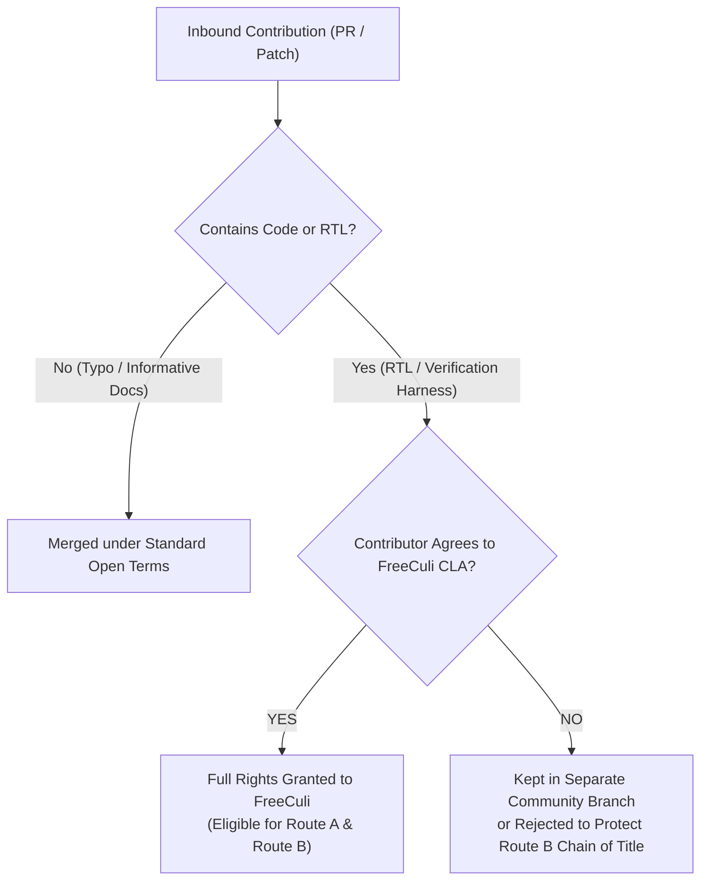

# FREECULI ZC-CORE — v4.0.0 License Scope & Rights Matrix

**Project:** FreeCuli ZC-CORE Hardware Architecture & Methodology
**Target:** v4.0.0 Normative Migration & RFC Transition
**Document Classification:** Legal Scope & Material Rights Matrix (Historical Evidence)
**File Location:** `evidence/legal/V4_LICENSE_SCOPE_AND_RIGHTS_MATRIX.md`
**Baseline Commit:** `96425c69376f27373c7b3819d28fc222f42f00cc`
**Branch:** `gate-c/formal-scope-audit`

**Governance Status:** `HISTORICAL AUDIT RECORD / INFORMATIONAL / NOT NORMATIVE`
**Gate Status (at Gate C Closure):** `Gate C: PARTIAL / QUALIFIED` | `Gate D: UNVERIFIED`
**Historical Release Constraint:** `DO NOT MERGE / RELEASE BLOCKED (Historical Gate C Stricture)`
**Legal Disclaimer:** This matrix categorizes materials, copyright claims, and licensing pathways for architectural governance and engineering implementation. It documents technical provenance and founder representations; it is not an independent legal title deed or accreditation opinion.

> [!NOTE]
> **Historical Governance Record (Gate C Review Baseline):**
> This matrix records the legal and licensing scope analysis originally performed during the Gate C review on branch `gate-c/formal-scope-audit` (commit `96425c6`). It is preserved as historical supporting evidence. The "DO NOT MERGE / RELEASE BLOCKED" constraint describes the gate state at that time and does not restrict subsequent candidate release candidate tracking.

---

## 1. Scope & Objective

To execute the Confirmed Corporate Strategy and prevent legal overreach or ambiguity, this matrix establishes a comprehensive rights chain across all ten (10) asset categories within the FreeCuli ZC-CORE ecosystem.

It explicitly defines:
1. The **exact legal regime** governing each class of material (Copyright, Open Hardware License, Open Standard, Trademark, or Public Domain / Prior Art).
2. The **chain of title** and licensing authority held by FreeCuli project / founder Oytun Ciba.
3. The precise boundaries where **CERN-OHL-S v2.0 reciprocity triggers**, and where **clean-room independence** protects third-party implementers.
4. Items requiring explicit corporate/founder attestation (`OWNER ATTESTATION RECORDED`).

---

## 2. 10-Category Rights and Licensing Matrix

| # | Material Category | Exact Repository Files / Scope | Current Governing License / Legal Regime | Provenance & Chain of Title | FreeCuli Authority to Grant Commercial Route B Exemption | Copyleft Reach & Reciprocity Trigger (Route A) | Clean-Room Independent Implementation Permitted? | Provenance & Attestation Status |
| :- | :--- | :--- | :--- | :--- | :--- | :--- | :--- | :--- | :--- |
| **1** | **Production RTL Modules** | `rtl/zc_aon_post_auth_ctrl.sv` `rtl/zc_obi_subordinate_bridge.sv` `rtl/zc_otp_pkg.sv` `rtl/zc_spi_flash_firewall.sv` | `CERN-OHL-S-2.0` (Strongly Reciprocal Open Hardware) | Authored by FreeCuli project / Oytun Ciba. | **YES (Subject to Founder Representation)** — Founder represents 100% sole development; Git history verified consistent. | Triggered upon distributing modified RTL or physical silicon/FPGA bitstreams derived directly from these RTL files. | **YES** — Independent RTL written from scratch to satisfy M1–M10 is 100% exempt from FreeCuli copyleft. | `FOUNDER REPRESENTATION RECORDED (ATTEST-01)` (100% of commits in `rtl/` by yemekyarismasi; independent title deed not audited). |
| **2** | **Hardware Schematics & PCB Layouts** | Reference PCB layouts, electrical schematics, BOMs, and Gerber files referenced in v3.x documentation. | `CERN-OHL-S-2.0` | Authored by FreeCuli project / Oytun Ciba. | **QUALIFIED (Contingent on Future Release)** — CAD/Gerber files from v3.x are not present in this candidate archive. Commercial exemption authority applies only if and when those separate reference hardware CAD files are released and verified. | Triggered upon distributing physical boards manufactured from or derived from FreeCuli reference schematics. | **YES** — Custom PCB layouts engineered independently without copying FreeCuli CAD/Gerber files are fully exempt. | `ASSETS NOT PRESENT IN ARCHIVE` (Excluded from current digital package). |
| **3** | **Verification Scripts & Tooling** | `scripts/verify_gate_b_rev28d.ps1` Future build automation scripts. | `CERN-OHL-S-2.0` *(Legacy text claimed AGPL-3.0)* | Authored by FreeCuli project / Oytun Ciba. | **YES** — FreeCuli owns scripts. Can license or relicence as needed. | Modifying and distributing the scripts themselves requires releasing script source. Running scripts does NOT contaminate hardware designs. | **YES** — Third parties may use their own test automation tools freely. | `VERIFIED` (Internal build tool). |
| **4** | **Normative Specifications & Standards** | `zero-cloud-core-methodology-invariants.md` `zero-cloud-core-scope-boundary.md` `zero-cloud-core-versioning-and-governance.md` `zero-cloud-core-attack-taxonomy.md` `docs/rfc/*.md` | Open Specification / Standard (Permissive documentation license; text protected by copyright, normative standard is open). | Authored by FreeCuli project / Oytun Ciba. | **NO (Not Applicable)** — The specification is free to read and implement. FreeCuli does not sell exemptions from reading the standard. | Implementing the standard does NOT trigger copyleft over the implementer's hardware. Standard texts may not be plagiarized without attribution. | **YES** — Anyone may implement the specification freely without paying FreeCuli. | `VERIFIED` (Open Specification Policy). |
| **5** | **Abstract Methodology & Architectural Principles** | The causal sequence: `Sensor Acquisition → Trusted Local Inference → Controlled Semantic Release → Absolute Raw-Data Destruction → Network Operation`; M1–M10 principles. | Public Domain / Open Technical Prior Art (Unpatentable by third parties due to defensive prior art disclosures). | Developed by Oytun Ciba / FreeCuli. | **NO** — Abstract ideas, functional requirements, and causal sequences cannot be copyrighted (17 U.S.C. § 102(b)). FreeCuli holds no patent monopoly. | **NONE** — Ideas and principles do not trigger copyright copyleft. | **YES** — Any organization can freely implement the methodology from first principles without a license. | `VERIFIED` (Fundamental Legal Principle). |
| **6** | **Conformance Test Suites (CTS) & Formal Harnesses** | `tb/tb_zc_obi.sv` `tb/tb_zc_otp.sv` `tb/tb_zc_spi.sv` `fv/zc_obi_formal_proof.sv` `fv/zc_spi_formal_proof.sv` `fv/zc_otp_formal_proof.sv` `fv/zc_m7_m8_ni_sva.sv` CTS documents. | `CERN-OHL-S-2.0` | Authored by FreeCuli project / Oytun Ciba. | **YES** — FreeCuli owns CTS harnesses and test specifications. | Distributing modified testbench harnesses requires source release. Executing CTS tests against a DUT does NOT trigger copyleft on the DUT. | **YES** — Implementers may write their own testbenches to verify compliance against CTS criteria. | `FOUNDER REPRESENTATION RECORDED (ATTEST-01)`. |
| **7** | **Trademarks, Brands & Badges** | Names: `FreeCuli`, `ZC-CORE`, `FreeCuli Certified™`, and associated graphical logos. | Trademark Law (Separate from Copyright / Open Hardware licenses). | Proprietary property of FreeCuli project / Oytun Ciba. | **YES (Exclusive Authority)** — Only FreeCuli can license the official certification mark and logos. | Trademark rights are never granted by CERN-OHL-S v2.0. Requires executing Level 4 Trademark License. | **NO** for using official marks/logos; **YES** for accurate, descriptive textual statements (e.g. "Designed to conform to ZC-CORE M1-M10"). | `COMMON-LAW MARK RECORDED (ATTEST-02)` (Formal registration certificates unverified in archive). |
| **8** | **Third-Party Upstream IP & Protocols** | OBI (OpenBus Interface) specification conventions; OpenTitan OTP architectural concepts; SPI protocol standards. | Industry Open Standards / Permissive Upstream Licenses (e.g. Apache 2.0 / OpenTitan, OBI Working Group). | Third-party standards bodies / OpenTitan project. | **NO** — FreeCuli CANNOT sell commercial exemptions for upstream third-party IP that it does not own. | Upstream licenses (e.g., Apache 2.0) must be respected according to their own terms (attribution notices preserved). | **YES** — Protocols and standard bus interfaces are open for public implementation. | `VERIFIED` (Upstream protocol usage conforms to fair use and open interface specs). |
| **9** | **External & Community Contributions** | Any past or future pull requests, issue contributions, or third-party patches. | Submissions made under `CERN-OHL-S-2.0` without contributor assignment agreements. | Retained by individual contributors unless transferred via Contributor License Agreement (CLA). | **QUALIFIED / RESTRICTED** — FreeCuli CANNOT sublicense third-party contributions under proprietary Route B without a CLA granting sublicensing rights. | Third-party contributions merged under CERN-OHL-S are bound by CERN-OHL-S reciprocity. | **YES** — Independent work is always permitted. | `FOUNDER REPRESENTATION RECORDED` (100% of current code in archive authored by Oytun Ciba). |
| **10** | **Defensive Publications & Technical Prior Art** | Zenodo Concept DOI 10.5281/zenodo.22838473; GitHub releases/commits; `zero-cloud-core-defensive-publication.md`. | Public Defensive Disclosure (35 U.S.C. § 102; EPC Art. 54). Dedicated to the public domain for prior-art purposes. | Published by FreeCuli / Oytun Ciba. | **NO** — Defensive publications cannot be commercially monopolized. Their legal function is to permanently prevent anyone (including FreeCuli) from obtaining patents on disclosed matter. | None. Prior art disclosures are freely citable and usable by the public worldwide. | **YES** — Third parties are encouraged to practice disclosed prior art without fear of patent infringement from FreeCuli. | `VERIFIED` (Zenodo persistent records). |

---

## 3. Deep-Dive on Commercial Authority Boundaries

### 3.1. What FreeCuli CAN Authorize Under Route B (Commercial Exemption)
FreeCuli holds the lawful right to grant paid commercial exemptions **solely for materials where FreeCuli holds 100% unencumbered copyright ownership**:
1. **FreeCuli's Reference RTL (`rtl/*.sv`):** A licensee may pay FreeCuli for a proprietary license to incorporate `zc_aon_post_auth_ctrl.sv`, `zc_obi_subordinate_bridge.sv`, `zc_otp_pkg.sv`, or `zc_spi_flash_firewall.sv` into an ASIC or closed-source FPGA netlist without releasing their modified RTL or surrounding SoC designs under CERN-OHL-S v2.0.
2. **FreeCuli's Reference PCB Schematics and CAD Files:** If and when released, a licensee may pay FreeCuli to use FreeCuli's reference board designs without publishing their proprietary PCB layout files or BOMs.
3. **Official Trademarks & Certification Badges:** FreeCuli exclusively controls the "FreeCuli Certified™" mark and can grant commercial licenses for marketing display.

### 3.2. What FreeCuli CANNOT Demand or License Under Route B
1. **Independent Clean-Room Implementations:** If a company (e.g., Bosch, Siemens, Aselsan) develops its own RTL and schematics to implement M1–M10 from scratch, FreeCuli has **zero legal authority** to demand a commercial license fee, royalties, or source code disclosure under copyright law.
2. **Upstream Third-Party IP:** FreeCuli cannot exempt any party from complying with third-party open-source obligations (e.g., Apache 2.0 notices for OpenTitan-derived concepts, or RISC-V international standards).
3. **Community Contributions (Without CLA):** If outside developers contribute RTL to the repository without signing a CLA assigning copyright or granting sublicensing rights to FreeCuli, FreeCuli cannot include those contributed lines of code in a proprietary commercial exemption package.

---

## 4. Contributor Rights & Inbound Licensing Policy for v4.0.0

To protect the integrity of Route B dual-licensing while maintaining an open community, v4.0.0 establishes the following formal policy:

### Mandatory Inbound Invariants:
1. **Current Code in Archive:** Founder Oytun Ciba represents 100% sole authorship of current RTL and testbenches, consistent with reviewed Git history.
2. **Future External Contributors:** If external developers contribute to production RTL, FreeCuli must either:
   - Require a lightweight Contributor License Agreement (CLA) granting FreeCuli commercial sublicensing rights; OR
   - Keep community contributions strictly under CERN-OHL-S v2.0, meaning FreeCuli could only offer commercial exemptions for its own core modules.

---

## 5. Owner Attestation Status & Records

- [x] **ATTESTATION-01 (RTL Provenance & Sole Development):** Founder representation recorded in `evidence/audit/V4_LICENSE_AND_RIGHTS_RISK_REGISTER.md` (ATTEST-01: 100% of commits in `rtl/` authored by `yemekyarismasi <ajibaoytun@gmail.com>`). Documents founder's representation; not characterized as an independent legal title deed.
- [x] **ATTESTATION-02 (Brand & Trademark Representation):** Founder representation recorded (ATTEST-02: Common-law "™" source identification for `FreeCuli` and `ZC-CORE`).
- [ ] **ATTESTATION-03 (No Conflicting Grant/Patent Obligations):** Founder representation recorded; signed formal institutional release certificate unverified in archive.
- [ ] **ATTESTATION-04 (Registered Trademarks):** Common-law mark claimed; formal trademark registration certificates unverified in archive.

---
*End of License Scope & Rights Matrix — FreeCuli ZC-CORE Architecture Review.*
